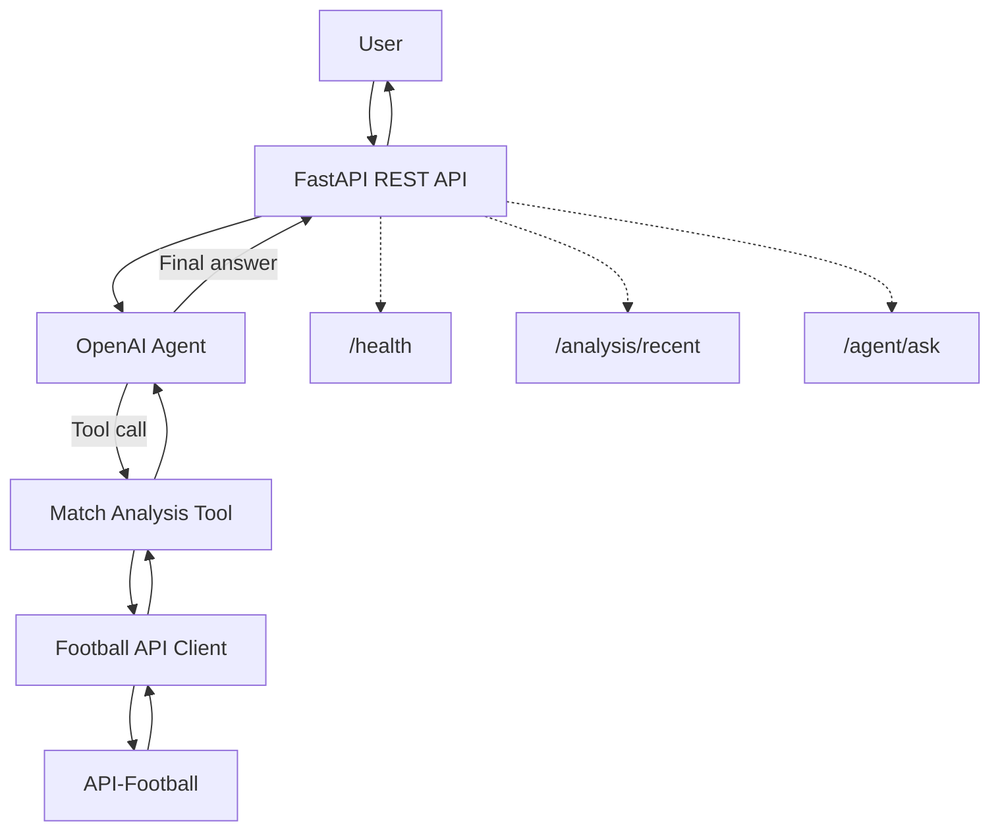

# United Intelligence – Architecture

United Intelligence is an AI-powered football analysis assistant for Manchester United. It uses FastAPI to expose an API, OpenAI to interpret questions and select tools, and API-Football to retrieve match data.

## Components

- **FastAPI:** Exposes health, match-analysis, and AI-agent endpoints.
- **OpenAI Agent:** Interprets user questions and calls the match-analysis tool when needed.
- **Match Analysis Tool:** Calculates wins, draws, losses, goals, goal difference, and points.
- **Football API Client:** Retrieves fixture data from API-Football.
- **API-Football:** External source of football fixture data.
- **Google Cloud Run:** Hosts the deployed API.

## Request flow

1. A user submits a question to `/agent/ask`.
2. FastAPI passes the question to the OpenAI agent.
3. The agent calls the match-analysis tool when current match statistics are needed.
4. The tool retrieves fixtures through the football API client.
5. The analysis tool calculates the statistics and returns structured results.
6. The agent generates a natural-language answer and returns it through FastAPI.
